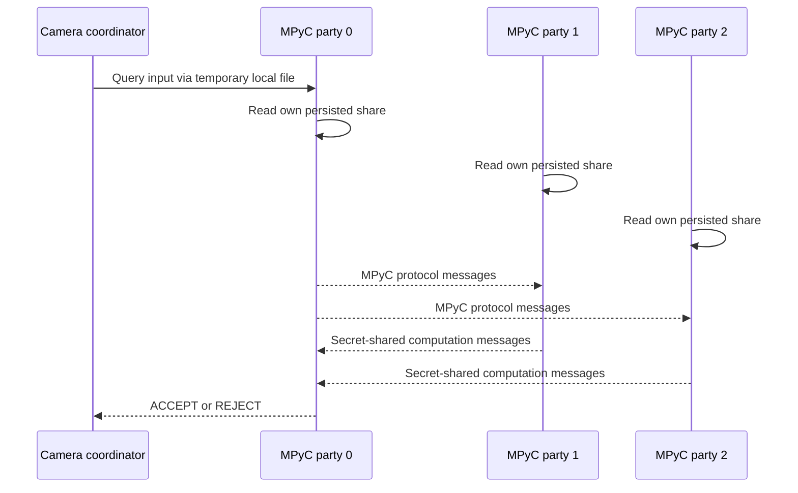

# Architecture

## Phase 1 status

The repository started empty. The system will use a coordinator, three independent party services, and MPyC for the secure computation stage.

- Party count: 3
- Passive corruption threshold: 1
- Reconstruction/computation threshold: 2
- Default party endpoints: `127.0.0.1:8001`, `127.0.0.1:8002`, `127.0.0.1:8003`
- Face detector: OpenCV Zoo YuNet
- Face recognizer: OpenCV Zoo SFace
- Authentication metric: cosine similarity, subject to fixed-point feasibility validation
- Fixed-point smoke configuration: 12 fractional bits; shifted coordinate encoding for secure signed arithmetic
- Persistence: one database file per party
- Failure behavior: fail closed when the required computation cannot complete
- Party control API: authenticated with `X-Party-Token` for share operations; bounded client timeout

## Trust and disclosure boundaries

The coordinator processes the input image and therefore temporarily handles biometric-derived data. Parties receive secret shares rather than a complete template. The intended MPC result is an authentication decision; any values necessarily opened by the selected protocol will be documented after implementation and tests.

Running all processes on one machine does not provide independent hardware, operating-system, or network trust boundaries.

## Feasibility gates

1. Verify model licenses, checksums, ONNX metadata, and OpenCV API behavior.
2. Quantify fixed-point encoding error and field bounds.
3. Demonstrate persisted share injection into a three-party MPyC computation.
4. Demonstrate secure threshold comparison with deterministic vectors.

Detailed flow diagrams will be updated to match the implemented protocol as it is built.

## Implemented coordinator lifecycle

The coordinator generates three shares and sends one share to each party. Create operations roll back already-completed party writes if a later party fails. Replacement first retrieves the current shares and restores completed replacements if a later replacement fails. Deletion attempts all parties and reports incomplete deletion rather than claiming success.

## Webcam enrollment

`scripts/enroll_webcam.py` opens the selected local camera through OpenCV, previews frames, and accepts a frame only after the user presses `E` while the face pipeline confirms exactly one usable face. The frame is converted to a normalized SFace embedding, fixed-point encoded, and passed to the coordinator. The coordinator distributes one Shamir share to each authenticated party. The frame and embedding remain process-local and are not persisted by the enrollment command.

## Current authentication disclosure

The user-facing webcam authentication path invokes MPyC. Each party process reads only its own persisted share, the query is secret-shared into the computation, and only the decision is opened to party 0. The coordinator does not reconstruct the enrolled template on this path. The current local launcher uses a temporary query JSON on the shared filesystem, so query confidentiality between local processes is not equivalent to a remote deployment with authenticated private input channels. The file is deleted when the launcher exits.

